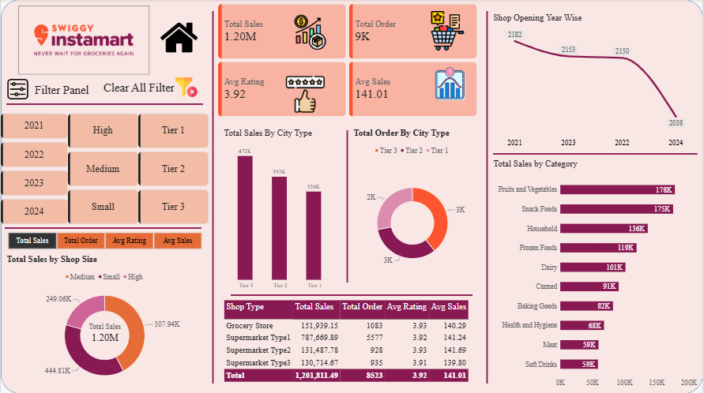
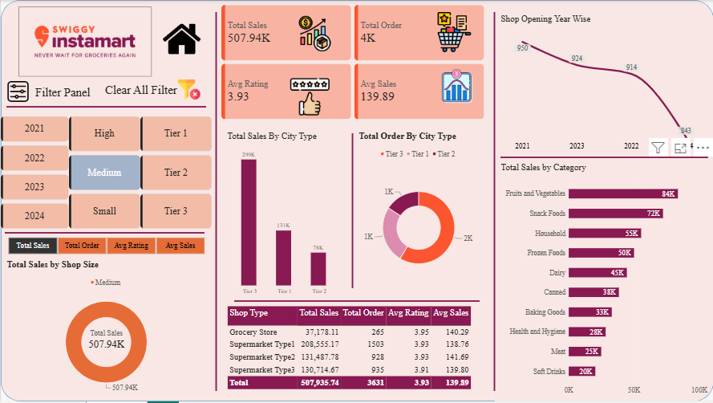
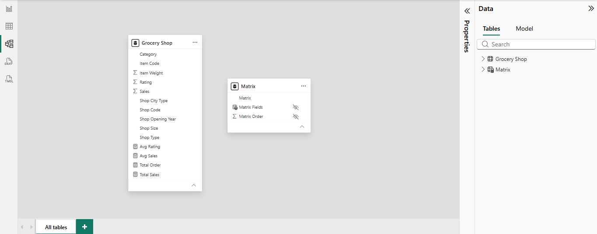
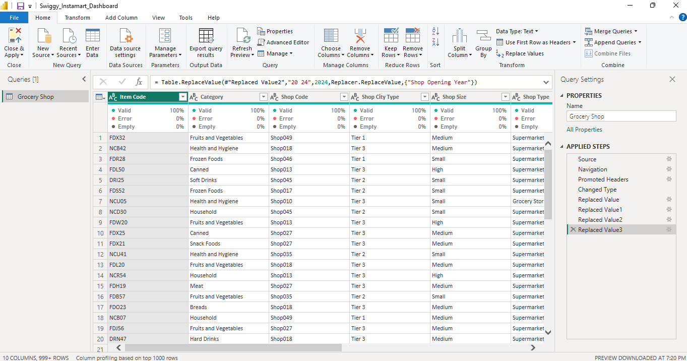

# Swiggy Instamart Sales Analytics Dashboard (Power BI)

## Project Overview
An interactive Power BI dashboard built on 8,523 grocery records from Swiggy Instamart. Raw data was cleaned and transformed in Power Query, then modeled and visualized in Power BI to show sales performance by city type, shop type, shop size, product category, and shop opening year.

## Business Questions Answered
- What are the total sales, total orders, average sales, and average rating?
- Which city types drive the most sales and orders?
- Which product categories generate the highest sales?
- How do sales differ by shop size and shop type?
- How has the number of shops changed by opening year?

## Tools Used
- Power Query (data cleaning and transformation)
- Power BI Desktop (data modeling, DAX measures, dashboard design)
- Microsoft Excel (source data)

## Dataset
- Source: [add dataset source, e.g. Kaggle link or "practice dataset"]
- Records: 8,523
- Main fields: Shop Type, Shop City Type, Shop Size, Shop Opening Year, Category, Sales, Orders, Rating

## Data Cleaning (Power Query)
- Handled missing values in the dataset
- Corrected data types and standardized column values
- [Add any other steps you performed, e.g. removed duplicates, renamed columns]

## Dashboard Features
- **KPI cards:** Total Sales, Total Orders, Average Sales, Average Rating
- **Total Orders by City Type** (donut chart)
- **Total Sales by City Type** (column chart)
- **Total Sales by Category** (bar chart)
- **Total Sales by Shop Size** (donut chart)
- **Shop Type summary table** with sales, orders, average rating, and average sales
- **Shop Opening Year trend** (line chart)
- **Slicers:** Shop Opening Year, Shop Size, and City Type, plus a Filter Panel and a Clear All Filter button

## Key Insights
- The business generated **1.20M in total sales across about 9K orders**
- **Tier 3 cities** contributed the most sales at **472K**
- **Fruits & Vegetables** was the top category at **178K**, followed by **Snack Foods** at **175K**

## Screenshots

### Dashboard Overview

### Filtered View

### Data Model

### Power Query Steps

## Repository Files
- `Swiggy_Instamart_Dashboard.pbix` - Power BI report file
- `Swiggy_Instamart_Dashboard.pdf` - PDF export of the dashboard
- `01_dashboard_overview.png`, `02_filtered_view.png`, `03_data_model.png`, `04_power_query_steps.png` - screenshots

## How to Open
1. Download `Swiggy_Instamart_Dashboard.pbix`.
2. Open it in Power BI Desktop (free for Windows).
3. Use the slicers to filter the dashboard.

## Author
**Animesh Mishra**
- Email: mishra.animesh2005@gmail.com
- LinkedIn: [Animesh Mishra](https://www.linkedin.com/in/animesh-mishra-da/)
- GitHub: [animesh-mishra-da](https://github.com/animesh-mishra-da)
